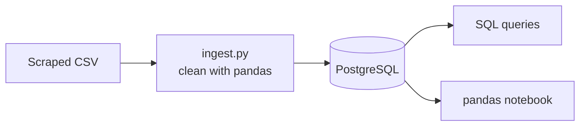
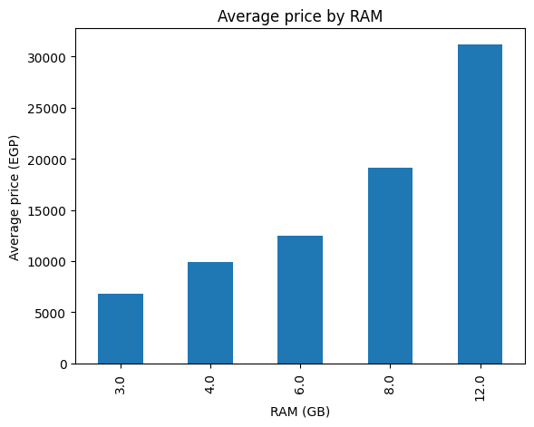
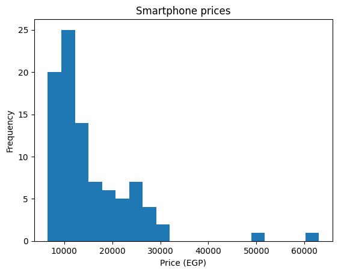

# Noon Phones Data Pipeline

I scraped phone listings from noon.com (Egypt) and wanted to practice everything that comes after the scraping: cleaning messy text, loading it into a real database, and answering questions about it with SQL and pandas. This repo is that whole path, running in Docker.

> Educational project. It uses a small sample of publicly listed product information and is not affiliated with noon.

## How it works



1. A CSV of scraped listings sits in `data/`.
2. `ingest/ingest.py` cleans it with pandas and loads it into a PostgreSQL table called `noon_phones`.
3. I ask questions of that table in two ways: SQL (`analysis/queries.sql`) and pandas (`analysis/analysis.ipynb`).

Docker Compose runs PostgreSQL, pgAdmin and the ingest script. The Python environment is managed with [uv](https://docs.astral.sh/uv/).

The scraper itself is not in this repo. It produced the CSV beforehand.

## The messy part

The scraped file was almost entirely text, so most of the work was turning it into something a database can use:

| In the scraped file | After cleaning |
|---|---|
| price `22,500` | `22500.0` |
| before_discount `EGP 20999.00` or `no discount` | `old_price` as a number, or empty |
| rating_nums `1768 Ratings` or `No rating` | `rating_count` of `1768` or `0` |
| ranking `Best Seller #8 in Smartphones` | `best_seller_rank` 8 and `category` Smartphones |
| selling_vendor `Sold by noon` | `vendor` noon |
| delivery `Get it Tomorrow / Order in 2h 55m` | `Tomorrow` (the countdown only reflects when I scraped) |
| title `... 8GB RAM 256GB ...` | `brand`, `ram_gb` 8 and `storage_gb` 256 |
| the same phone scraped twice | one row |

Titles like `16GB(8+8)RAM` mean 8 GB of real RAM plus 8 GB of virtual RAM, so I store the real 8.

## Run it yourself

You need Docker Desktop. You only need uv if you want to open the notebook.

```bash
git clone https://github.com/Youssefay-cloud/noon-phones-data-pipeline.git
cd noon-phones-data-pipeline

docker compose up -d db pgadmin
docker compose run --rm --build ingest
```

The last command prints how many rows it loaded into `noon_phones`. By default it loads `data/sample.csv`, a 40-row sample of my scrape.

**Look at the data in pgAdmin**

1. Open http://localhost:8085 and log in with `admin@admin.com` / `change_me`.
2. Right-click Servers, then Register, then Server. Name it anything.
3. On the Connection tab use host `db` (not `localhost`), port `5432`, database `noon`, username `root`, password `change_me`.
4. Open Databases, noon, Schemas, public, Tables, and right-click `noon_phones`.

**Run the analysis**

- SQL: open `analysis/queries.sql` in pgAdmin's Query Tool and run the queries one by one.
- pandas: run `uv sync`, then open `analysis/analysis.ipynb` in VS Code or Jupyter and pick the `.venv` kernel.

**Use your own data**

Put your CSV in `data/` and change `sample.csv` to your file name in the `ingest` service of `docker-compose.yml`. The cleaning expects the same columns as my scrape.

**Start over:** `docker compose down -v` deletes the database so you can load fresh.

## What I found

These numbers come from my full scrape (99 listings, 92 of them smartphones). The sample file only has 40 rows, so you will get different numbers from it.

- **Prices:** the median smartphone costs 12,749 EGP but the average is 15,402 EGP, because a few flagships (Galaxy S25 Ultra, iPhone 15) pull the average up.
- **RAM drives price:** 3 GB phones average about 6,800 EGP, 8 GB phones about 19,150 EGP and 12 GB phones about 31,160 EGP.
- **Price and rating:** expensive phones are rated slightly better, but the link is weak (correlation 0.43).
- **Discounts:** 38 of 92 phones are discounted, and the biggest discount is 24%.
- **noon vs other stores:** every phone sold by noon itself has next-day delivery, against 24% of phones from other sellers, at similar prices.
- **Best sellers:** the top 10 have a median price of 6,999 EGP against about 11,500 EGP for the rest, but 6 of the 10 are the same Itel phone in different colours.





## Limits

- It is one scrape, so it describes the market on one day. It says nothing about how prices change.
- The same phone appears once per colour, so a row is a listing, not a unique phone.
- Only about half of the rows have specs, because the product pages for the other half did not load when I scraped. That is a bug in my scraper that I still need to fix.
- 99 listings is small. I treat the findings as things I noticed, not as facts about the whole market.

## What I learned

- Cleaning took longer than analysing. The scraped prices, ratings and delivery dates all needed work before they were usable.
- Inside Docker, `localhost` is the container itself. The ingest container and pgAdmin reach the database at `db`, the service name from the compose file.
- The mean can mislead when a few items are very expensive. The median is a better "typical" price.
- `uv sync` tries to build your own project as a package unless you tell it not to, so the Dockerfile uses `--no-install-project`.

## What's next

- Fix the scraper so every listing has its specs, and run it on several days to track price changes.
- Keep the raw data in its own table and clean it in a separate step.
- Schedule the whole run instead of starting it by hand.

## Project layout

```
.
├── analysis/
│   ├── analysis.ipynb     pandas questions and answers
│   └── queries.sql        SQL questions
├── data/
│   └── sample.csv         40-row sample of the scrape
├── docs/                  charts used in this README
├── ingest/
│   ├── Dockerfile
│   └── ingest.py          cleans the CSV and loads it into PostgreSQL
├── docker-compose.yml     PostgreSQL, pgAdmin and the ingest job
├── pyproject.toml         Python dependencies (managed with uv)
└── uv.lock
```
